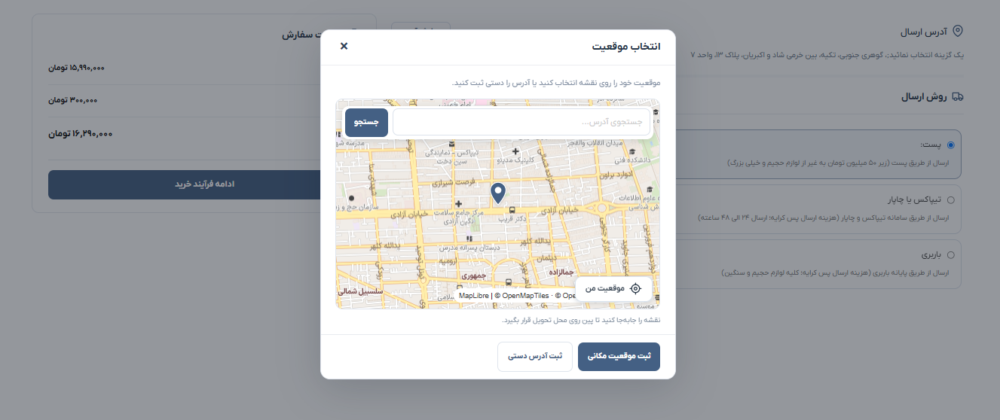
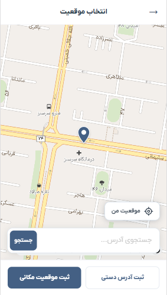
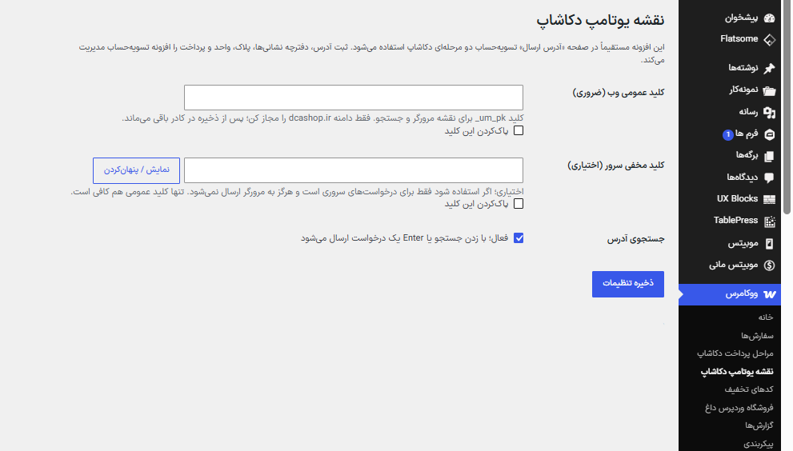

# 🗺️ Dcashop Uttamap

A custom **Uttamap-powered location picker for WooCommerce**, developed by **Seyyed Behzad Mousaviyan**. It connects the **Dcashop two-step checkout** with an interactive map, address lookup, and saved delivery coordinates, while keeping WooCommerce checkout and order management in place.

**Release:** `v1.0.0` · **First Public Release** · **WordPress / WooCommerce / PHP / JavaScript**

---

## 📌 Overview

**Dcashop Uttamap** adds map-based location selection to the address modal used by the Dcashop two-step checkout. Customers can move the map to place a center marker, use their current location, optionally search for an address, and confirm the selected delivery position.

The plugin also provides a **WooCommerce admin order map** for orders with saved delivery coordinates.

## ✨ Features

- 📍 **Interactive Location Picker** — Place a delivery marker by moving the map.
- 🗺️ **MapLibre + Uttamap** — Loads an Uttamap map using MapLibre GL JS.
- 🔎 **Optional Address Search** — Search for locations when address search is enabled.
- 🎯 **Use My Location** — Browser-based geolocation with an Iran-area boundary check.
- 🏠 **Address Lookup** — Resolve the selected position into street, province, and city information when the provider returns these fields.
- ✍️ **Manual Address Fallback** — Continue with a manually entered address when an automatic result is unavailable.
- 📱 **Responsive RTL Interface** — Checkout map layouts for both desktop and mobile devices.
- 🛒 **WooCommerce Checkout Integration** — Works with the custom Dcashop two-step checkout address modal.
- 📦 **Order Delivery Map** — Show saved order coordinates in the WooCommerce admin order screen, with an external Google Maps link.
- 🔐 **API Key Settings** — Configure a public web key and an optional server-side secret key.
- ⚡ **Optimized Requests** — Includes a short server-side request limit and selective fallback for address lookup.

## 🔄 How It Works

1. The customer opens the **address/location dialog** in the Dcashop checkout.
2. The Uttamap map loads with a **center location marker**.
3. The customer moves the map, uses **My Location**, or searches for an address (when enabled).
4. The plugin resolves the chosen location through Uttamap and returns available address information to the checkout.
5. The checkout handles the remaining address fields and stores delivery coordinates with the order.
6. Authorized store administrators can view the stored location in the **WooCommerce order details**.

## 📸 Screenshots

### 🖥️ 1. Checkout Map — Desktop

Interactive location selection within the shipping address dialog, including map navigation, search, and the location confirmation button.



### 📱 2. Checkout Map — Mobile

Full-height mobile map with a centered delivery marker, accessible search field, geolocation action, and confirmation controls.



### ⚙️ 3. WordPress Map Settings

WooCommerce administration screen for managing Uttamap public and optional secret keys and enabling address search.



## 🧩 Requirements & Integration

- **WordPress** with **WooCommerce** enabled.
- **PHP 7.4+** (the minimum stated in the plugin header).
- **Classic WooCommerce checkout** and the **Dcashop Two-Step Checkout** address interface for the integrated map modal.
- **Uttamap public web API key** (`um_pk_...`) with access configured for your website domain.
- Optional **Uttamap server secret key** (`um_sk_...`) for server-side requests.
- Network access to Uttamap services and the MapLibre GL JS CDN.

> **Compatibility note:** This plugin was designed for the Dcashop checkout workflow. It is not a general-purpose replacement for every WordPress map or checkout extension.

## 🚀 Installation

1. Back up the WordPress site before modifying the checkout.
2. Ensure **WooCommerce** and the **Dcashop Two-Step Checkout** plugin are configured.
3. Download **`dcashop-uttamap-v1.0.0-wordpress.zip`** from the GitHub release assets.
4. In WordPress, open **Plugins → Add New → Upload Plugin** and upload the ZIP file.
5. Activate **Dcashop Uttamap**.
6. In **WooCommerce → Dcashop Uttamap map settings**, enter the Uttamap **public web API key**. A server secret key is optional.
7. Enable or disable **Address Search** as required, then save the settings.
8. Open the checkout address dialog and verify the map, geolocation, search (if enabled), address resolution, and saved delivery location.
9. Place a test order in a staging environment and verify that the selected delivery location appears in the WooCommerce order details.

**Important:** Keep the **secret server key** private; it is not required in the browser. Restrict the public web key to the domain(s) used by your storefront.

## 🗺️ Address & Order Data

- Returns **street**, **province**, and **city** information only when Uttamap provides those components.
- Does **not** invent or automatically fill a postal code.
- Preserves the existing checkout coordinate field: `billing_map_lat_long`.
- Can read supported coordinate metadata from orders to display the delivery point in WooCommerce admin.
- Uses existing Dcashop checkout selectors and JavaScript integration identifiers for compatibility.

## 📂 Project Structure

```text
dcashop-uttamap/
├── assets/
│   ├── checkout-map.js
│   ├── checkout-map.css
│   ├── admin-order.js
│   └── admin-order.css
├── screenshots/
│   ├── 01-checkout-map-desktop.png
│   ├── 02-checkout-map-mobile.png
│   └── 03-wordpress-map-settings.png
├── dcashop-uttamap.php
├── README.md
└── CHANGELOG.md
```

## 📦 Release

**v1.0.0 — First Public Release**

See [CHANGELOG.md](CHANGELOG.md) for release highlights.

## 👨‍💻 Developer

**Seyyed Behzad Mousaviyan**  
WordPress & WooCommerce Developer  
GitHub: [@behzad79](https://github.com/behzad79)
